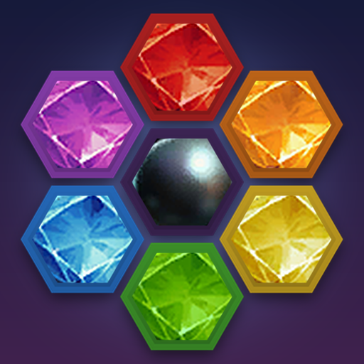
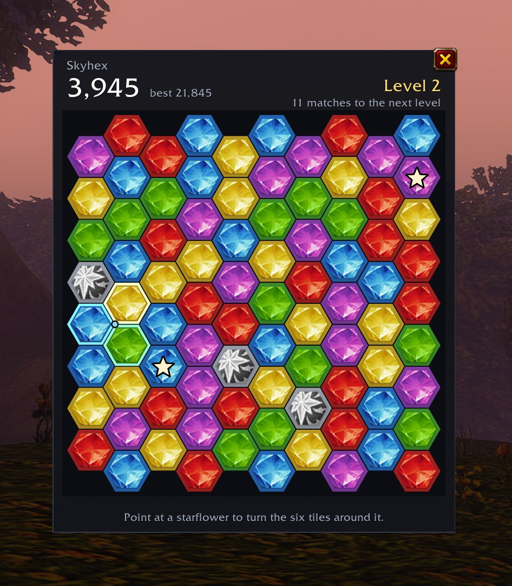

<div align="center">



# Skyhex

*A hex gem puzzle for WoW: Forever that opens when your flight takes off and keeps your board between flights.*

[](LICENSE)
[](#install)
[](https://github.com/lovelaced/skyhex/tags)



</div>

Skyhex turns the minutes on a flight path into a puzzle game. Turn gems three at a time to match colors, ring a gem with six of one color to make a starflower, and ring one with six starflowers to make a black pearl. Your board waits for you between flights, on every character on your account.

## Features

- **Opens when you fly**: the board appears as your flight takes off and stays open when you land, unless you'd rather it hid.
- **One board that keeps going**: one run per account, carried across flights and characters and kept after every move.
- **Starflowers and black pearls**: build up from matches to starflowers to black pearls. Touching black pearls win the run.
- **Bombs**: from level 3, bombs drop in with a countdown. Match their color before it hits zero.
- **Seven levels**: more colors, shorter bomb counters and bigger scores as you climb. Level 7 goes on forever.
- **Two gem styles**: glossy cut gems, or the classic World of Warcraft gem icons with a different shape for each color.
- **Practice boards**: see a starflower, a black pearl, a bomb or a win happen without touching your run.

## Install

Skyhex isn't on CurseForge yet. To install it now:

1. Download the zip from the [latest release](https://github.com/lovelaced/skyhex/releases/latest).
2. Unzip it into `World of Warcraft/_forever_/Interface/AddOns/`, so you end up with `AddOns/Skyhex/Skyhex.toc`.
3. Restart the game.

Skyhex only loads on WoW: Forever.

## How to play

Take a flight and the board opens, or type `/skyhex` anywhere. The first time, pick a starting level: 1, 3 or 5.

- **Turn**: point at the board and three gems light up. Left click turns them clockwise, right click turns them the other way. A turn keeps going, up to a full circle, until it makes a match. If nothing matches, the gems end up where they started and the move still counts.
- **Match**: three or more touching gems of one color clear, and new gems fall in from the top. From level 2, some gems carry a star. Each star in a match doubles its points.
- **Starflower**: ring a gem with six gems of one color, and the center turns into a silver starflower. Point at a starflower to turn the six tiles around it.
- **Black pearl**: ring a gem with six starflowers to make a black pearl. Point at a black pearl to turn the three tiles its spokes touch.
- **Win**: three black pearls touching each other, or a ring of six, win the run.
- **Bombs**: from level 3, a bomb drops in every 15 matches, then every 10 from level 4. Each move counts every bomb down by one. Match a bomb's color before it reaches zero, or the run ends. Defuse a bomb with a starred gem of its color to clear that color from the whole board.
- **Levels**: each level takes 50 to 100 matches, counting chain reactions. Levels 4 and 6 each add a color, and bombs start lower on every level from 3 to 7.

If no move can make a match, the board reshuffles for free. To move the window, drag it anywhere outside the board.

## Settings

Find Skyhex under **Options > AddOns**, or type `/skyhex options`.

| Setting | Default | What it does |
|---|---|---|
| Open when you take a flight | On | Opens the board as your flight takes off |
| Hide when you land | Off | Puts the board away when your flight lands. Your board is kept either way |
| Gem style | Modern gems | Glossy cut gems, or the classic gem icons with a different shape for each color |
| Sound effects | On | Turns, clears, bomb ticks and level-ups |
| Window size | 100% | From 70% to 150% |

## Commands

| Command | What it does |
|---|---|
| `/skyhex` | Opens or closes the board |
| `/skyhex options` | Opens Skyhex in the game's Options |
| `/skyhex auto on`, `off` | Opens the board when you take a flight, or not |
| `/skyhex land hide`, `stay` | Puts the board away when you land, or keeps it open |
| `/skyhex gems modern`, `classic` | Picks a gem style |
| `/skyhex new` | Starts a new run |
| `/skyhex scale 0.7` to `1.5` | Resizes the window |
| `/skyhex sound on`, `off` | Turns sound effects on or off |
| `/skyhex reset` | Puts the window back in the middle of the screen |
| `/skyhex try flower`, `pearl`, `bomb`, `wipe`, `win` | Opens a practice board one move away from that event |

You can also open the board from the addon button on your minimap.

## Saving

Your run belongs to your account, so any character can pick it up. Skyhex keeps it after every move, and WoW writes it to disk when you log out or type `/reload`. If the game crashes, you lose the moves since then.

## Reporting a bug

[Open an issue](https://github.com/lovelaced/skyhex/issues) and describe what you saw. If the game showed a Lua error, paste it in too.

## Development

The tests run outside the game and need [LuaJIT](https://luajit.org/).

```bash
make test      # rule specs and a short fuzz run
make boot      # boots the addon in an offline WoW harness and plays through flights, saving and settings
make lint      # luacheck
make deploy    # copies the addon into the game (set WOW_DIR if yours isn't the default macOS path)
make package   # builds Skyhex-<version>.zip in .release/
```

`make boot` uses the offline harness from [Perl Infinity](https://github.com/lovelaced/perl-infinity). Set `PI_HARNESS` to its `tests/harness/init.lua` if it isn't at `~/git/perl-infinity`. `make snap` (window mockups) and `make icon` read icon art straight from your local WoW: Forever install with `tools/casc.py`, which only reads.

The rules live in `Skyhex/Engine/`, plain Lua with no game calls. A move resolves at once and hands the UI a list of steps to animate, so the saved board is always a settled one. Rules that no source could pin down are marked `PROPOSAL` in the code.

`notes/research/forever-api.md` collects what Skyhex relies on in Forever's addon API: flight detection, masks, sounds, saved variables and icons.

## License

Skyhex is free software under the [GPL-3.0-or-later](LICENSE). The gem, starflower and black pearl art, and the icon made from it, come from World of Warcraft, © Blizzard Entertainment.
