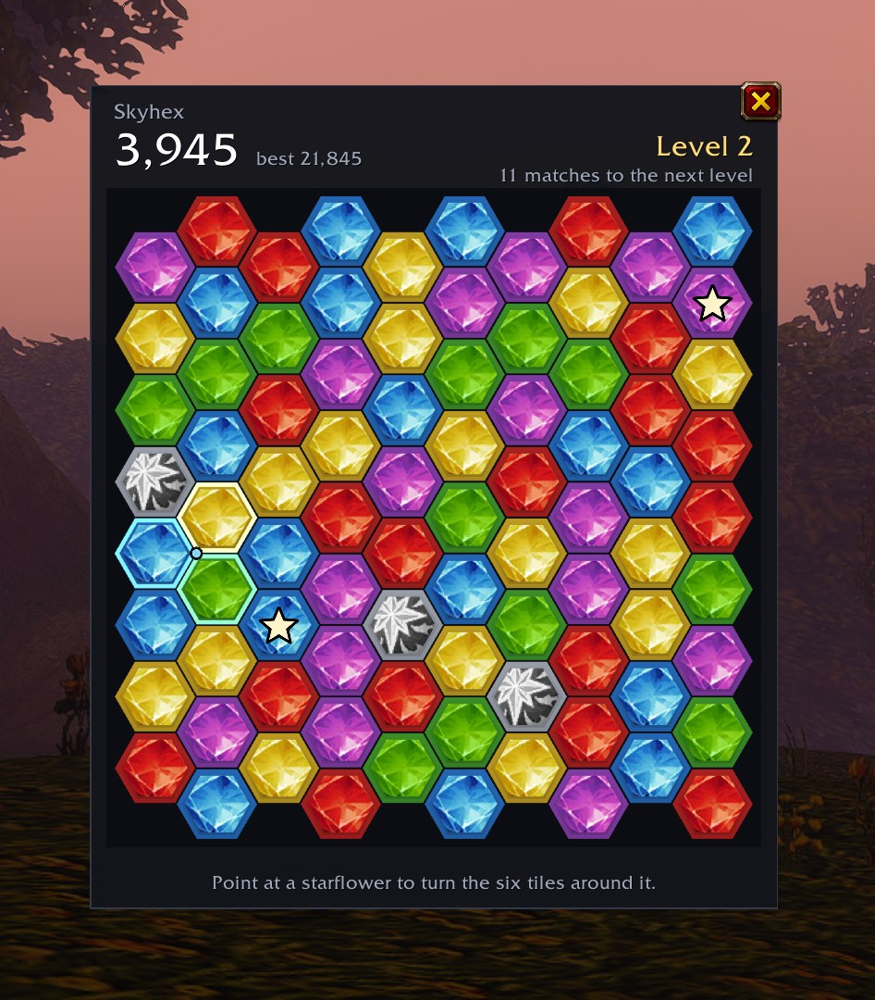

# CurseForge project page

Paste-ready text for the Skyhex project on CurseForge. Keep it in step with the README when features change.

## Project settings

| Field | Value |
|---|---|
| Name | Skyhex |
| Summary | A hex gem puzzle that opens when your flight takes off and keeps your board between flights. |
| Category | Minigames |
| License | GNU General Public License version 3 (GPLv3) |
| Logo | `assets/logo.png` |
| Images | `assets/screenshots/board.jpg` |
| Source | https://github.com/lovelaced/skyhex |
| Issues | https://github.com/lovelaced/skyhex/issues |
| Game version | WoW: Forever 1.60.1 |

## Description

Paste everything below the line into the description editor in Markdown mode.

---

**Skyhex turns the minutes on a flight path into a puzzle game.** Turn gems three at a time to match colors, ring a gem with six of one color to make a starflower, and ring one with six starflowers to make a black pearl. Your board waits for you between flights, on every character on your account.

### What you get

- **Opens when you fly.** The board appears as your flight takes off and stays open when you land, unless you'd rather it hid.
- **One board that keeps going.** One run per account, carried across flights and characters and kept after every move.
- **Starflowers and black pearls.** Build up from matches to starflowers to black pearls. Touching black pearls win the run.
- **Bombs.** From level 3, bombs drop in with a countdown. Match their color before it hits zero.
- **Seven levels.** More colors, shorter bomb counters and bigger scores as you climb. Level 7 goes on forever.
- **Two gem styles.** Glossy cut gems, or the classic World of Warcraft gem icons with a different shape for each color.
- **Practice boards.** Type `/skyhex try pearl` (or flower, bomb, wipe, win) to see one happen without touching your run.

### How to play

- Point at the board and three gems light up. **Left click** turns them clockwise, **right click** the other way. A turn keeps going until it makes a match.
- Three or more touching gems of one color clear. Gems with a star double the points of their match.
- Point at a starflower to turn the six tiles around it, or at a black pearl to turn the three tiles its spokes touch.
- Each move counts every bomb down by one. Defuse a bomb with a starred gem of its color to clear that color from the whole board.

### Settings

Find Skyhex under **Options > AddOns**, or type `/skyhex options`. You can turn off opening on takeoff, put the board away when you land, switch gem styles, turn off sound and resize the window. Type `/skyhex help` for every command.

### Good to know

- Skyhex only loads on WoW: Forever.
- WoW writes your board to disk when you log out or type `/reload`. If the game crashes, you lose the moves since then.
- Skyhex is free and open source under the GPL. Bug reports and the code are on [GitHub](https://github.com/lovelaced/skyhex).
